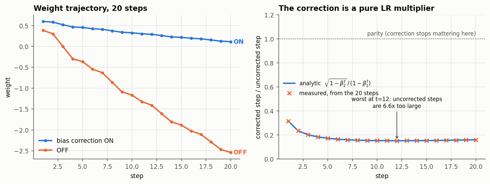
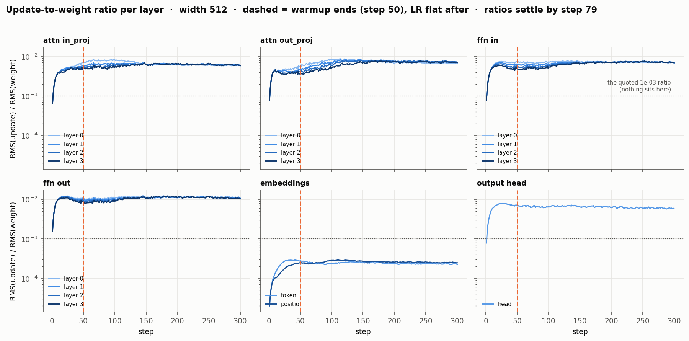
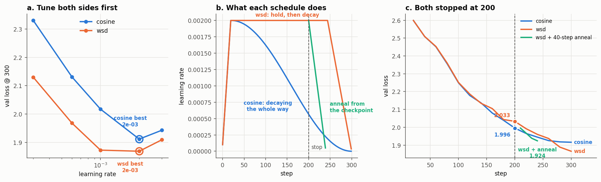
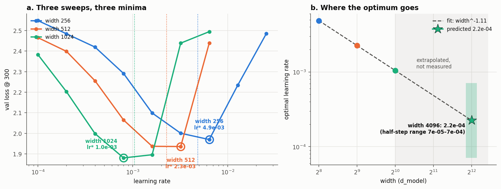

# Adam, by hand and under load

Five questions about the optimizer, answered with numbers rather than recollection:
reproduce Adam exactly, price bias correction, watch the update-to-weight ratio per
layer, race two schedules with **both sides tuned**, and find where the learning rate
optimum goes as the model gets wider.

Everything here is reproduced by `./run_all.sh`. Parts 1–2 are CPU and take seconds.
Parts 3–5 train a 4-layer character transformer on TinyShakespeare and took about
2h20m end to end on an Apple M1 (MPS) — roughly 3 min, 45 min and 95 min respectively.

---

## The five answers, up front

| # | Question | Answer |
|---|---|---|
| 1 | Does hand-rolled Adam match PyTorch? | Yes — to **5.6e-17**, i.e. float64 round-off. Not "several decimals", all of them. |
| 2 | After how many steps does bias correction stop mattering? | **~3,900 steps** to within 1% (β₂=0.999) — *not* 20. At step 20 the uncorrected update is still **6.2× too large**. The timescale is set by β₂ alone. |
| 3 | When does warmup stop changing the update ratio? | LR stops moving at the warmup boundary (**step 50**), but the ratios keep drifting to **step 79 (median), 143 (worst)**. |
| 4 | Cosine or WSD, both stopped at 200? | Cosine by 0.038 at exactly step 200 (**1.9956** vs **2.0333**). But 40 more steps annealing the WSD checkpoint gives **1.9243**, beating cosine at equal compute (1.9450). **Keep WSD.** |
| 5 | What LR at width 4096? | **2e-4.** Fit gives 2.25e-4 with lr\* ∝ width^−1.11. Confident in the exponent, not in the digits — a half-grid-step wobble spans **10×**. |

---

## Setup

```bash
uv venv .venv && uv pip install --python .venv/bin/python -r requirements.txt
PY=.venv/bin/python ./run_all.sh        # PY defaults to python3
```

| | |
|---|---|
| Model | 4-layer pre-norm decoder, `d_model` ∈ {256, 512, 1024}, head_dim pinned at 64, FFN 4× |
| Data | TinyShakespeare, character level, 65-token vocab, 90/10 split, seq 128, batch 32 |
| Optimizer | AdamW, β=(0.9, 0.95), wd=0.1, grad-clip 1.0 |
| Eval | 20 fixed validation batches, identical for every run, so runs are comparable |
| Device | auto: CUDA → MPS → CPU |

Parameterization is **standard, not muP** — deliberately. Part 5 measures how the
optimal LR moves with width, which is exactly the thing muP is designed to remove.

### Running parts 4–5 on Colab

The scripts pick the device themselves, so nothing changes. On a T4 the two sweeps
take roughly 25 minutes instead of 100:

```python
!git clone <your-repo> && cd S11 && pip install -q -r requirements.txt
!cd S11 && python -u exp3_schedules.py | tee results/exp3_schedules.txt
!cd S11 && python -u exp4_lr_width_sweep.py | tee results/exp4_lr_width.txt
from google.colab import files; files.download('S11/results/exp4_lr_width.json')
```

Drop the returned `results/*.json` back into `results/` and the numbers in this
README are the ones the plots were built from.

---

## Part 1 — Adam by hand

`exp1_adam_by_hand.py`. One scalar weight `w₀ = 0.7`, five gradients
`[0.5, −0.3, 0.8, 0.1, −0.6]`, `lr = 0.1`, `β = (0.9, 0.999)`, `eps = 1e-8`.

Step 1 in full, by hand:

```
m₁ = 0.9·0     + 0.1·(0.5)       = 0.05
v₁ = 0.999·0   + 0.001·(0.5²)    = 0.00025
m̂₁ = 0.05    / (1 − 0.9¹)       = 0.5
v̂₁ = 0.00025 / (1 − 0.999¹)     = 0.25
Δ  = 0.1 · 0.5 / (√0.25 + 1e-8)  = 0.09999999…
w₁ = 0.7 − 0.1                   = 0.6
```

All five steps, hand-computed, with PyTorch's answer subtracted:

| t | g | m | v | m̂ | v̂ | step | w | \|w − torch\| |
|---|---|---|---|---|---|---|---|---|
| 1 | 0.50 | 0.05000000 | 0.00025000 | 0.50000000 | 0.25000000 | 0.10000000 | 0.60000000 | 0 |
| 2 | −0.30 | 0.01500000 | 0.00033975 | 0.07894737 | 0.16995998 | 0.01914980 | 0.58085020 | 0 |
| 3 | 0.80 | 0.09350000 | 0.00097941 | 0.34501845 | 0.32679677 | 0.06035364 | 0.52049656 | 0 |
| 4 | 0.10 | 0.09415000 | 0.00098843 | 0.27377145 | 0.24747868 | 0.05503250 | 0.46546406 | 5.6e-17 |
| 5 | −0.60 | 0.02473500 | 0.00134744 | 0.06040146 | 0.27002800 | 0.01162366 | 0.45384040 | 5.6e-17 |

**Worst disagreement across `m`, `v` and `w` over all five steps: 5.551e-17.** The
script asserts `< 1e-12`, so `run_all.sh` fails loudly if this ever stops being true.

Two things worth noticing while the numbers are small enough to see:

- **Step 1 is exactly `lr`.** `m̂₁ = g` and `v̂₁ = g²` by construction, so the ratio is
  `sign(g)` and the step is `±lr` regardless of how big the gradient was. That is the
  bias correction doing its job on the very first step, and it is why Adam's first
  step does not care whether your loss scale is 1 or 10⁶.
- **Step 2 is 5× smaller than step 1** even though `|g₂| = 0.3` is a perfectly
  ordinary gradient. The sign flip drops `m` to 0.015 while `v` keeps rising — Adam
  short-steps through direction changes without being told to.

PyTorch computes this as `step_size = lr/bc₁`, `denom = √v/√bc₂ + eps`, which is
algebraically `lr·m̂/(√v̂ + eps)` — the same expression, arranged to avoid a division.
That rearrangement is the reason the agreement is at round-off rather than at 1e-8.

---

## Part 2 — What bias correction is actually worth



With the correction removed, the ratio of the two updates is

```
corrected step     √(1 − β₂ᵗ)
──────────────  =  ──────────
uncorrected step    (1 − β₁ᵗ)
```

`m` and `v` cancel, so **this does not depend on the gradients at all** — measured
against the formula across the 20 steps, worst deviation **1.94e-07** (that residual
is `eps`, not error). Disabling bias correction is not a different optimizer. It is a
fixed, gradient-independent multiplier on the learning rate, early in training only.

**The multiplier is worst in the middle, not at step 1.**

| t | 1 | 5 | 12 | 20 |
|---|---|---|---|---|
| ratio | 0.316 | 0.173 | **0.152** | 0.160 |
| uncorrected step is | 3.2× too big | 5.8× | **6.6×** | 6.2× |

It dips because `(1 − β₁ᵗ)` saturates in ~40 steps while `√(1 − β₂ᵗ)` needs
thousands. Between those two timescales the correction is at its most aggressive.

### The number asked for

**"After how many steps does the difference stop mattering?" — about 3,900, given
β₂ = 0.999.** Twenty steps is nowhere near it. Over the plotted window the two
trajectories separate monotonically and the weights end **2.65 apart** on a weight
that started at 0.7.

Steps until the multiplier is permanently within tolerance of 1:

| β₂ | within 10% | within 5% | within 1% |
|---|---|---|---|
| **0.999** (default) | 1,660 | 2,327 | **3,916** |
| 0.99 | 166 | 232 | 390 |
| 0.95 | 6 | 42 | 76 |

β₁ does not appear in the answer: it has saturated long before any of these. The
closed form is `t ≈ log(1 − (1−tol)²) / log(β₂)`.

So the honest answer has a condition attached. *If* you train for the few thousand
steps that β₂ = 0.999 assumes, bias correction is a transient and stops mattering at
roughly step 4,000. If you run 300-step experiments — like parts 3–5 of this
assignment — it never stops mattering, and dropping it silently multiplies your
early LR by up to 6.6×. Lower β₂ to 0.95 and the whole question closes by step 76,
which is one reason short-horizon work tends to use it.

This is also the cleanest argument for warmup: without correction the optimizer
opens with a large-LR transient of exactly the shape warmup exists to suppress, and
the two mechanisms overlap. Part 3 measures that overlap directly.

---
## Part 3 — Update-to-weight ratio, per layer

`exp2_update_ratios.py`. Width 512, 300 steps, `lr = 1e-3`, **warmup 50 then flat**.
Logged every step, for every parameter tensor: `RMS(Δw) / RMS(w)`, where `Δw` is the
actual post-step weight change (captured by diffing the tensor around `opt.step()`,
so it includes weight decay and gradient clipping — not a reconstruction from `m` and `v`).

The schedule is flat after warmup on purpose. Under cosine you cannot separate "the
ratio settled because warmup ended" from "the ratio settled because cosine started
pulling the LR back down". Holding the LR constant after warmup makes the question
answerable at all.



### When does warmup stop changing it?

Two different answers, and the gap between them is the interesting part.

- **Step 50, trivially.** Warmup owns the LR until step 50 and nothing after. Any
  change past that is not warmup.
- **Step 79 (median), step 143 (worst), measured.** Taking "stops changing" as *stays
  within 20% of its final plateau*, only **8 of 19** tensors settle exactly at the
  warmup boundary. The rest keep drifting for up to 93 steps more.

| settles at | tensors |
|---|---|
| 50 (= warmup end) | both embeddings, `head`, layer 0 FFN, 2 × `attn.in_proj`, layer 1 `linear2` |
| 63–103 | most of the FFN and middle-layer attention |
| 112–143 | layer 3 `linear1` (112), layer 3 `attn.out_proj` (113), layer 0 `attn.in_proj` (131), layer 0 `attn.out_proj` (143) |

All four `attn.out_proj` tensors land in the slow half (79, 101, 113, 143), and three
of them come close to **doubling** their ratio *after* warmup has ended — layer 3 goes
3.7e-3 → 7.2e-3 (1.9×), layer 2 4.2e-3 → 7.5e-3 (1.8×), layer 1 4.6e-3 → 7.4e-3 (1.6×).
So warmup stops driving the ratio at 50,
but the ratio is not stationary until about 143 — the residual motion is `v` still
filling up and the weights reorganizing, not the schedule. **If you use the update
ratio as a health check, do not read it before ~3× your warmup length.**

### The ratio factorises, and the spread is not what it looks like

Plateau ratios span **2.3e-04 to 1.1e-02 — 49×** across tensors, and *nothing* sits at
the ~1e-3 figure usually quoted as healthy. That looks alarming and isn't. Rescaling
each plateau by its own weight norm:

| quantity | across all 19 tensors |
|---|---|
| `RMS(Δw) / RMS(w)` — the logged ratio | 2.3e-4 → 1.1e-2 (**49× spread**) |
| `RMS(Δw) / lr` — the same updates, unnormalized | 0.195 → 0.248 (**mean 0.208, ±10%**) |

So `RMS(Δw)/RMS(w) = (0.21 · lr) / RMS(w)`. The numerator is flat — Adam's step is
bounded by `lr` and gradient noise damps it to ~0.21·`lr` here, identically for every
tensor. **The entire 49× spread is `RMS(w)`, i.e. initialization scale**: `nn.Embedding`
initializes `N(0,1)` (RMS ≈ 1.0 at init, 0.98 at the end of this run), `nn.Linear`
initializes `U(±1/√fan_in)` (RMS ≈ 0.028).

Concretely: the embeddings are not learning 30× more slowly than the FFN. They take
the *same size step*; they are simply 36× larger to begin with. Reading the raw ratio
as a per-layer learning-rate diagnostic would have gotten that exactly backwards —
and this per-tensor asymmetry between embeddings and matrices is precisely what muP
corrects by assigning them different LR scalings.

---
## Part 4 — Cosine vs WSD, both stopped at step 200

`exp3_schedules.py`. Width 512, 300-step budget, warmup 20, identical data order for
every run.

### Tuning both sides first

> *"Almost every optimizer claim that failed to replicate was a well tuned method
> measured against a badly tuned one."*

So neither schedule gets to borrow the other's learning rate. Each is swept over the
same five-point grid at the planned 300-step budget, and only the winners meet:

| lr | 3e-4 | 6e-4 | 1e-3 | **2e-3** | 3e-3 |
|---|---|---|---|---|---|
| cosine, val@300 | 2.3304 | 2.1310 | 2.0173 | **1.9117** | 1.9430 |
| WSD, val@300 | 2.1301 | 1.9681 | 1.8728 | **1.8689** | 1.9093 |

**Both pick 2e-3**, so the head-to-head is at one shared LR — but now that is a
measured outcome rather than an assumption, which is the whole point of the exercise.
The script also re-runs the selection against val@200 in case stopping early would
have justified a different LR; it doesn't (2e-3 either way), ruling out that confound.

Worth noting in passing: WSD's curve is much flatter near its optimum (1.8728 vs
1.8689 across a 2× LR change) while cosine's has a clear point (2.0173 → 1.9117 →
1.9430). WSD was the more forgiving schedule to tune here.



### The two losses asked for

| model | steps | val loss |
|---|---|---|
| **cosine @ 200** | 200 | **1.9956** |
| **WSD @ 200** | 200 | **2.0333** |

**Cosine is ahead by 0.0377 at the stop point.** It should be: cosine had already
decayed its LR to 5.66e-4 by step 200, while WSD was still running flat out at 2e-3.
You are comparing a partly-annealed model against one that has not started annealing.

For scale: two runs of the identical config differ by **0.0011** here (MPS kernel
nondeterminism, measured from the duplicated `lr=2e-3` run). Every gap below is 20–45×
that, so none of them are noise. This is a single seed per configuration, though —
a rough floor, not a variance estimate.

### Which model would I keep? **WSD.**

The 2.0333 is not a model anyone would ship, and that is the thing the step-200
comparison hides. A WSD checkpoint is *designed* to be annealed from wherever it
happens to be. Doing that — 40 more steps, LR decayed linearly to zero:

| model | steps | val loss | |
|---|---|---|---|
| cosine @ 240 | 240 | 1.9450 | fair-compute control |
| **WSD @ 200 + 40-step anneal** | **240** | **1.9243** | **wins by 0.0207** |
| cosine @ 300 | 300 | 1.9163 | if it had finished |
| WSD @ 300 | 300 | **1.8659** | if it had finished |

So the ordering reverses twice, and each reversal is legitimate:

1. **At exactly 200 steps, cosine wins** (1.9956 vs 2.0333). If you must ship the
   step-200 weights untouched, take cosine.
2. **At 240 steps, WSD wins** (1.9243 vs 1.9450). Spending 20% more compute converts
   the WSD checkpoint into a better model than cosine reaches with the same total.
3. **At the planned 300, WSD wins by more** (1.8659 vs 1.9163).

I would keep WSD, because the property being bought is *optionality*. Cosine's LR
schedule is a commitment to a step count made before training starts; stop it anywhere
other than 300 and you get a model whose LR was mid-flight, with no way to recover the
annealing except by re-running from scratch on a new schedule. WSD's stable phase
means every checkpoint is 40 steps away from being a properly annealed model, so the
decision of when to stop can be made *after* seeing the loss curve rather than before.

The honest caveat: cosine@300 (1.9163) still beats WSD@240 (1.9243) — if you have the
full budget and actually intend to use it, cosine is not broken and costs nothing extra.
WSD's advantage here is specifically about not having committed. Given the question
stipulates an unplanned stop at 200, that is exactly the situation it is built for.

---
## Part 5 — Sweeping the LR across width

`exp4_lr_width_sweep.py`. Widths 256 / 512 / 1024, cosine, 300 steps, warmup 20,
one seed per point. Val loss at step 300:

| lr | 1e-4 | 2e-4 | 4e-4 | 8e-4 | 1.6e-3 | 3.2e-3 | 6.4e-3 | 1.28e-2 | 2.56e-2 |
|---|---|---|---|---|---|---|---|---|---|
| **256** | 2.5484 | 2.4843 | 2.4196 | 2.2911 | 2.0989 | 2.0003 | **1.9697** | 2.2345 | 2.4853 |
| **512** | 2.4655 | 2.3987 | 2.2556 | 2.0646 | 1.9368 | **1.9356** | 2.4391 | — | — |
| **1024** | 2.3830 | 2.2023 | 1.9984 | **1.8804** | 1.8957 | 2.4388 | 2.4946 | — | — |

The grid is wider at width 256 because it had to be. On the shared 7-point grid, 256's
minimum sat on the top edge at 6.4e-3 and was still descending — a bound, not a minimum.
The script detects this itself (`[AT GRID EDGE — widen the grid]`) and `--resume` adds
the two extra points without re-running the other 21. It matters: fitting with 256
pinned at the edge gave slope **−1.31** and a width-4096 prediction of **1.63e-4**;
with the minimum actually resolved, **−1.11** and **2.25e-4**. A grid that is too narrow
does not fail loudly, it just biases the answer.



### The three minima

Grid spacing is 2×, so the grid argmin is only good to ±√2. Each `lr*` below is the
vertex of a parabola fitted in log-LR through the argmin and its two neighbours:

| width | grid argmin | **lr\*** (parabola vertex) | best val |
|---|---|---|---|
| 256 | 6.4e-3 | **4.86e-3** | 1.9697 |
| 512 | 3.2e-3 | **2.27e-3** | 1.9356 |
| 1024 | 8.0e-4 | **1.04e-3** | 1.8804 |

Successive ratios are **2.14×** and **2.18×** — each doubling of width slightly more
than halves the optimal LR. In log-log:

```
log₂(lr*) = −1.109 · log₂(width) + 1.192          R² = 1.0000  (3 points, 1 dof)
```

**lr\* ∝ width^−1.11**, against the **width^−1** that standard parameterization predicts.
That the measured exponent lands within 11% of the theoretical one is the main reason
to take the extrapolation at all seriously. (R² = 1.0000 is *not* a reason — three
points and one degree of freedom will fit a line beautifully whether or not the law
is real.)

Two things the sweep shows that a single-width sweep cannot:

- **The safe LR band narrows as the model widens.** 6.4e-3 is the *optimum* at width
  256 (1.9697) and is *catastrophic* at width 1024 (2.4946). One learning rate, opposite
  verdicts, purely from width.
- **Overshooting costs far more than undershooting.** Moving ~3× above `lr*` costs
  +0.56 / +0.50 / +0.27 val loss at widths 1024 / 512 / 256; moving ~3× *below* costs
  +0.12 / +0.13 / +0.13. The minima are cliffs on the right and ramps on the left, at
  every width.

### What LR would I use at width 4096, and how confident am I?

**I would start at 2e-4**, marginally below the fitted point estimate of **2.25e-4**,
and I hold that with **moderate confidence in the trend and low confidence in the
digits**.

Rounding down is not timidity, it is the asymmetry above: a 3× overshoot costs ~4×
what a 3× undershoot costs, so when the estimate itself is uncertain the loss-minimizing
choice sits below the point estimate.

**What supports it:**

- Three widths fall on a straight line in log-log with consistent successive ratios
  (2.14×, 2.18×).
- The fitted exponent (−1.11) is close to the theoretically expected −1.
- An independent, theory-anchored estimate agrees: take width 1024's measured
  `lr* = 1.04e-3` and apply exactly `width^−1` for the two remaining octaves →
  **2.6e-4**, within 15% of the fitted 2.25e-4. Both land in 2–3e-4.
- The width-512 vertex is robust to its own ambiguity: its two best points (1.9368 at
  1.6e-3, 1.9356 at 3.2e-3) differ by 0.0012 — a coin flip — but fitting the parabola
  around *either* of them gives 2.27e-3 vs 2.28e-3. The tie does not move the answer.

**What undercuts it, in order of severity:**

1. **It is a two-octave extrapolation from three points.** 1024 → 4096 is as far again
   as the entire measured range. Perturbing each measured minimum by half a grid step
   swings the prediction across **7.1e-5 – 7.1e-4, a 10× band**. That band, not R², is
   the real uncertainty.
2. **Optimal LR depends on the training horizon, and these are 300-step runs.** A real
   width-4096 model trains for far longer, and longer horizons prefer lower LRs. The
   2.25e-4 is conditional on this recipe and is more likely an over-estimate than an
   under-estimate for a long run — which is a second, independent reason to round down.
3. **One seed per point.** The measured run-to-run noise floor is ~0.001 val loss
   (part 4), and width 512's two best points are separated by 0.0012. Some of these
   minima are determined to within roughly one noise unit.
4. **Standard parameterization is the wrong tool for this job.** The entire reason
   `lr*` moves is that the parameterization lets it. Under muP the exponent would be
   ~0 and the width-256 tuning result would transfer to 4096 directly.

**So the honest recommendation is conditional.** If I must pick blind: 2e-4. But the
sweep at width 1024 cost about 25 minutes here, and a single failed run at width 4096
costs vastly more than measuring three points near 2e-4 would. The result I actually
trust from this experiment is not the number — it is the **exponent**, which says a
4× width increase needs roughly a 4.3× LR cut, and which turns a blind search into a
three-point confirmation. And if the choice were mine at the design stage, I would
switch to muP and delete the extrapolation problem rather than get better at it.

---
## What's in the repo

| file | what it does |
|---|---|
| `common.py` | model, data, schedules, the training loop, the plot style — shared by parts 3–5 |
| `exp1_adam_by_hand.py` | parts 1 & 2 — hand Adam vs torch, bias correction on/off (CPU, seconds) |
| `exp2_update_ratios.py` | part 3 — per-layer update-to-weight ratios (~3 min) |
| `exp3_schedules.py` | part 4 — tune both schedules, race them, anneal the checkpoint (~45 min) |
| `exp4_lr_width_sweep.py` | part 5 — LR × width sweep, minima, extrapolation (~90 min) |
| `results/*.txt`, `results/*.json` | every number in this README, as produced |
| `figures/*.png` | every figure, regenerable from the JSON |

Both sweep scripts take `--replot` to rebuild their figure from saved JSON without
retraining, and `exp4` takes `--resume` to add grid points to an existing sweep.
`results/exp4_lr_width_basegrid.txt` is the pre-widening run, kept because the
difference between it and the final result is part of the story.

## Method notes

Things done deliberately, each because the alternative would have produced a
prettier but less trustworthy number:

- **Both sides tuned before every comparison.** Part 4 sweeps each schedule
  separately and only then races the winners; part 5 widens the grid until each
  width's minimum is interior. The one time this was skipped (the shared grid at
  width 256) it silently moved the final answer by 38%.
- **`Δw` is measured, not reconstructed.** Part 3 diffs the weights around
  `opt.step()`, so weight decay and gradient clipping are included. Computing
  `lr·m̂/(√v̂+ε)` instead would have reported the update the optimizer *intended*.
- **Identical data order across compared runs**, fixed by seed, and a fixed 20-batch
  validation set shared by every run in the repo.
- **A measured noise floor.** Two runs of one identical config differ by 0.0011 val
  loss (MPS nondeterminism). Quoted wherever a gap is close to it.

### Known limitations

- **One seed per configuration.** Parts 4 and 5 report single runs against a noise
  floor estimated from a single duplicated pair. Three seeds per point would put real
  error bars on the part-5 minima and is the first thing more compute should buy.
- **300-step horizon throughout.** Optimal LR and schedule ranking both depend on the
  training horizon; every conclusion here is conditional on it. Part 5 flags this
  explicitly because it biases the width-4096 extrapolation in a known direction.
- **Part 5 extrapolates two octaves from three points.** The exponent is the usable
  output; the specific LR is a starting point for a short confirmation sweep, not a
  substitute for one.
- **Parts 3–5 use β₂ = 0.95, part 1–2 use β₂ = 0.999** (the Adam paper's default, since
  parts 1–2 are about reproducing the published algorithm). Part 2's tolerance table
  covers both, which is why it is there.
